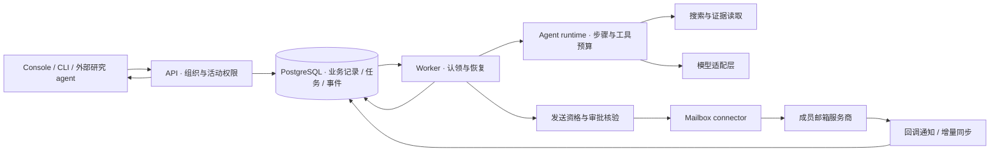

# 系统架构与部署

## 首版形态

采用 TypeScript 模块化单体。部署单元为一个 Web/API 进程、一个可横向扩展的 worker 和 PostgreSQL。控制台使用 React，HTTP 边界使用 JSON Schema 并发布 OpenAPI。CLI 与浏览器走同一应用服务。队列、幂等记录和业务状态共用数据库事务；首版免去单独维护消息中间件的成本。

| 拟建模块 | 持有的行为与数据 | 接口约束 |
| --- | --- | --- |
| apps/console、apps/cli | 人机交互、编辑、差异预览、事件订阅 | 只持用户会话或限权访问令牌；批准明确显示收件人、发件人、正文版本 |
| apps/api | 登录、workspace 成员关系、RBAC、资源读写、OAuth 回调、事件流 | 所有调用从身份推导组织后核对目标归属；对外订阅按资源权限裁剪 |
| packages/domain | 研究导入、联系人归并、发件资格、活动与消息状态机、指标投影 | 状态转移由领域命令完成，UI、agent 和批处理共用 |
| packages/agent、skills/ | run/step、模型选择、工具注册、预算与中断恢复 | 输出结构化产物；特权工具只暴露提案与审批队列入口 |
| packages/connectors | 模型、搜索、邮箱三种接口；厂商响应映射、本地模拟器 | 按实际能力声明草稿、发送、线程、回执与同步方式；凭据从密钥存储临时取用 |
| apps/worker | 任务租约、配额预留、投递、对账、同步、聚合与清理 | 只在提交持久意图后调用外部服务；对账和发送是不同类型的任务 |

## 生命周期与恢复

| 对象 | 状态及转移 | 中断后如何恢复 |
| --- | --- | --- |
| Campaign | draft → active ↔ paused → completed；草稿可归档 | 暂停后取消未交付任务或置为 held；恢复重新检查授权、时窗和抑制 |
| AgentRun | queued → running → waiting_review / waiting_auth / waiting_budget → running → completed；另有 failed / cancelled | 固定 skill、模型绑定和输入版本，按最后成功步骤恢复。对已付费但响应未知的调用记录预算占用，显式重试 |
| MessageRevision | drafted → in_review → approved；编辑产生新 revision，旧审批失效 | 审批指纹覆盖发件身份、收件人、回复线程、最终 MIME 内容及策略/事实版本 |
| Dispatch | scheduled → claimed → submitting → accepted / unknown / rejected；提交前可 held / cancelled | claimed 租约到期可重领；submitting 到期必须进入 unknown，查证结果后再转 accepted 或确定未交付的 rejected |
| Engagement | shortlisted → eligible → contacted → replied → negotiating → won / closed | 状态和计数从唯一事实事件更新；opt-out 与 bounce 有单独的抑制生命周期 |

**一次投递的事务边界。** API 批准并在同一事务中保存 revision、dispatch 和 outbox 事件。Worker 用行锁及到期租约领取 dispatch；锁定组织/邮箱额度桶、联系频控键和活动资格，校验抑制及权限版本，预留额度并把状态推进到 submitting 后提交事务，再调用服务商。重试使用相同 dispatch ID 和确定的 Message-ID（能力允许时）。外部请求期间不持数据库锁。邮箱已受理但写库前断电时，租约回收器发起查询；标识不足以证明结果则留在人工对账列表。仅明确证明未交付才可重排。无法在数据库与第三方服务间保证 exactly-once。

**并发退订和暂停。** 工作器在交付边界前最后检查联系人、身份和活动版本，发现变化即释放未使用的预留。退订事务先写抑制、撤销未提交的任务，并为已提交任务写取消请求或对账项。上游已受理可能无法撤回；UI 必须显示这条边界。重发、换成员、模板修改都不能重置抑制键。

**同步与回放。** Webhook 只负责验证来源并持久化通知，增量任务以邮箱和游标为单位同步。落库消息、事件和新游标同一事务提交；轮询修补漏通知。投影用 event ID 去重，消费位置按组织持久化，重建先写影子投影并核对统计后切换。报表展示数据水位。

## 隔离和信息流

所有组织内对象使用含 workspace ID 的复合外键。PostgreSQL 行级策略作为第二道隔离；应用角色无 BYPASSRLS，后台任务也须显式设置租户上下文。组织范围的归一化邮箱 HMAC 用于去重，地址和正文另以信封加密保存，密钥版本随记录保存。供应商 token 由独立凭据模块加密，读写、刷新与审计按 grant 分隔。

公共网页和来信正文都作为不可信输入。模型看到当前任务所需的公开资料、已批准品牌事实和经许可的最小正文。连接器返回联系点引用供运行时解析。原始凭据、其他成员邮件、整箱导出无进入模型上下文的接口。企业可禁用把来信交给外部模型，此时分类进入规则或人工队列。对外读取页面限定公共 HTTP(S)、受许可域/来源和大小，检查每次重定向的目标，禁访问内部服务。

默认只保存与活动匹配的消息；未匹配通知先保留受限信封摘要，过期清除。建议初始配置为未匹配摘要 7 天、正文及证据摘录 90 天、操作审计 180 天，部署者按地区和业务调整。删除联系人时清理正文、地址和模型产物，按配置仅保留履行拒联所需的最小抑制键。审计记录操作者、资源引用、策略版本和结果，日志使用内部 ID。

## 部署与观测

拟提供 Docker Compose（web、worker、postgres）与迁移命令；凭据加密主密钥由部署者注入，生产用 KMS 或外部密钥管理。实例需要稳定 HTTPS 回调地址，数据库使用持久卷及备份。首启走创建组织 → 注册模型/搜索凭据 → 连接邮箱 → 模拟活动 → 开启指定身份实发。邮件 worker 有独立的停发开关，收件和退订可继续工作。

关键观测为最老任务等待时间、submitting/unknown 滞留、邮箱授权失效、同步游标年龄、退信与退订处理延迟、模型与搜索预算使用量。按原因暂停受影响邮箱；无关组织继续运行。升级先做向后兼容的加列/索引，验证新旧 worker 能同时读取，再回填和切换。备份恢复后的第一步是停发并对账历史 submitting 记录。 [发布验收](delivery.md)
